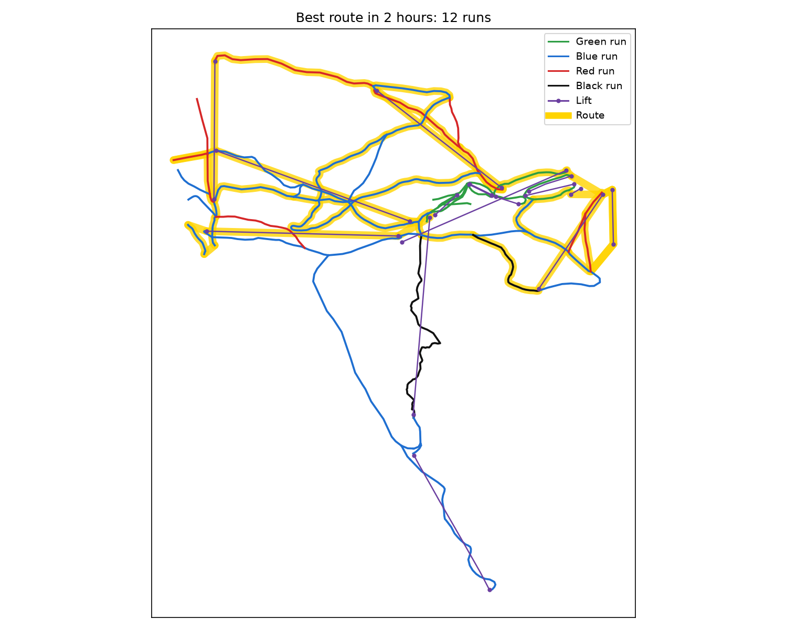
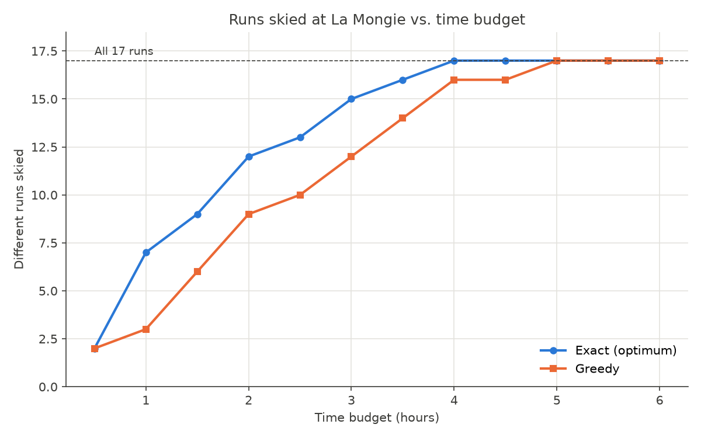
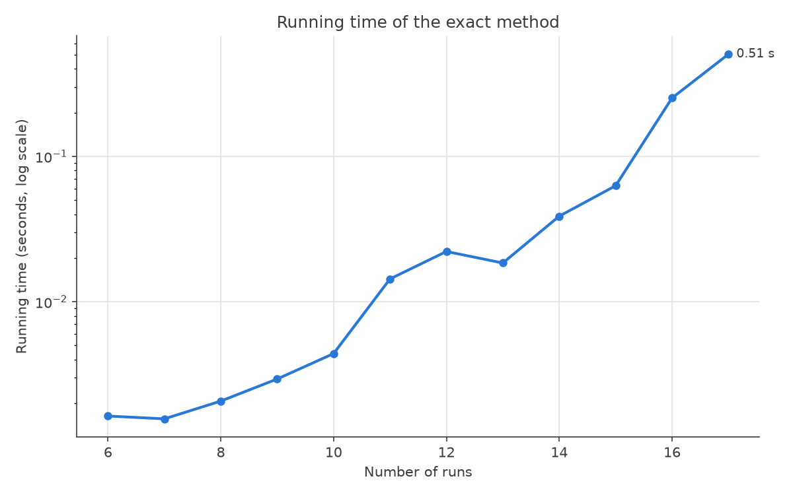

# How Many Runs Can You Ski in a Day?
Github username: adrien1709
Repository name: Planning-a-ski-day

When I ski a resort I don't know well, I spend the first lift ride trying to figure out how to see as much of the mountain as possible before the lifts close. This project answers that question with algorithms.

Given a ski area, a starting point at the base and a time budget, the program finds the route that skis the largest number of different runs and gets back to the base before time runs out.

<!-- TODO: ajouter image creer par le code -->

  

## The problem

Skiing a run a second time earns nothing, so the algorithm has to remember which runs it has already done. This makes the problem a version of the orienteering problem, which is NP-hard: with n runs there are 2n possible sets of runs to consider.

- With 20 runs, that is about 1 million sets. An exact algorithm can handle it.
- With 80 runs, that is about 1024 sets. No computer can check them all.

So the project works on two ski areas in the French Pyrenees:

| Ski area | Runs | Method |
|---|---|---|
| La Mongie | 20 | Exact algorithm (the true optimum) |
| Grand Tourmalet (La Mongie + Barèges) | 80 | Heuristics |

La Mongie is part of the Grand Tourmalet, so I can check how good the heuristics are on La Mongie, where I know the right answer, before trusting them on the whole ski area.

## Data

All the data comes from [OpenSkiMap](https://openskimap.org), which processes [OpenStreetMap](https://www.openstreetmap.org) ski data and publishes it as GeoJSON:

- Runs: https://tiles.openskimap.org/geojson/runs.geojson
- Lifts: https://tiles.openskimap.org/geojson/lifts.geojson
- Ski areas: https://tiles.openskimap.org/geojson/ski_areas.geojson

For La Mongie, I kept the downhill runs east of the Col du Tourmalet, removed the beginner runs (Baby, Plaine, Turon 2, Fusée, Vallée des Indiens, Adour) and the Pic du Midi cable cars.

## How it works

### 1. Building the graph

The ski area becomes a directed graph:

- **Nodes** are the start and end points of runs and the bottom and top stations of lifts. Endpoints that are only a few meters apart are merged into one node, because runs and lifts are drawn as separate lines in OpenStreetMap and don't always touch.
- **Edges** are runs (going downhill) and lifts (going uphill).
- **Weights** are durations in minutes: run length divided by an average speed that depends on difficulty, and lift length divided by the lift speed plus a waiting time.

The data gives the length of every run and lift, but not how long they take, so the speeds below are assumptions based on typical values. They are parameters in the code and can be changed.

| Edge | Default speed |
|---|---|
| Green and blue runs | 20 km/h |
| Red runs | 25 km/h |
| Black runs | 30 km/h |
| Chairlifts | 2.5 m/s |
| Drag lifts and platters | 2.5 m/s |
| Magic carpets | 0.5 m/s |
| Waiting time at each lift | 3 min |

### 2. The algorithms

| Algorithm | Role | Complexity |
|---|---|---|
| Dijkstra | Travel time from the end of each run to the start of every other run | O(E log V) per run |
| Dynamic programming over subsets | Exact optimal route on La Mongie | O(2n · n2) |
| Greedy | Always go to the nearest run not skied yet | Fast, no guarantee |
| Genetic algorithm | Evolves a population of routes over many generations | Slower, usually much better than greedy |

**Dijkstra** shrinks the full graph into a small table of travel times between runs. This does not lose the optimum: any real route can be read as the sequence of runs it skis for the first time, and the shortest paths between them can only be faster.

**The exact algorithm** is similar to the Held-Karp algorithm for the traveling salesman problem. `best[S][j]` is the shortest time needed to ski exactly the set of runs `S` and finish at the bottom of run `j`. States that already exceed the time budget are dropped as soon as they appear.

**The greedy algorithm** does what a skier improvising would do. It is very fast but can get stuck on one side of the ski area.

**The genetic algorithm** represents a route as an ordering of runs, skied in that order until the time runs out. It uses order crossover, swap and insertion mutations, and the number of different runs skied as the fitness.

## Results

<!-- TODO: ajouter image creer par le code -->

### Optimal route on La Mongie

<!-- TODO: image route trouver par le code -->

  

<!-- TODO: une ou deux phrase pour decrire ce que montre l'image -->

### Runs skied vs. time budget

<!-- TODO: image creer par le code en fonction du temps et de piste skier-->

  

<!-- TODO: from which budget can the whole ski area be done? -->

### Why the exact method stops at about 20 runs

<!-- TODO: running time of the exact algorithm for 10 to 20 runs, log scale -->

  

<!-- TODO: how much does the running time grow for each extra run? -->

### Heuristics vs. optimum

<!-- TODO: fill in with your own results (La Mongie, same time budget for every method) -->

| Method | Runs skied | Gap to optimum | Running time |
|---|---|---|---|
| Exact (dynamic programming) | | 0 | |
| Greedy | | | |
| Genetic algorithm | | | |

  

### Grand Tourmalet

<!-- TODO: best route found by the genetic algorithm on the whole ski area -->

  

<!-- TODO: how many runs does each heuristic find in a full day? -->

## Author

Adrien Diaz